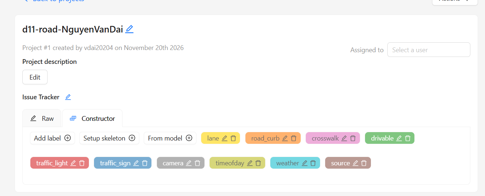
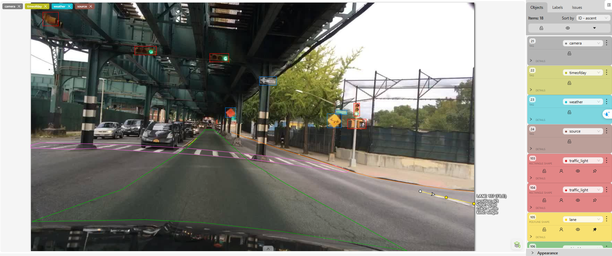
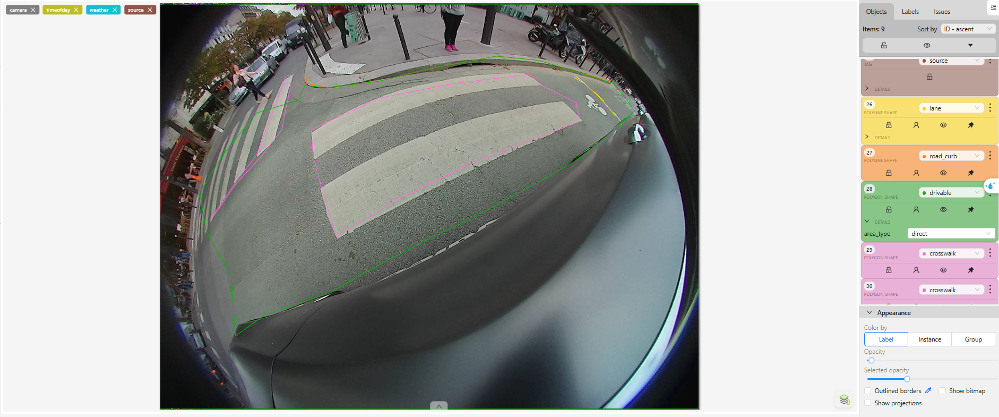

# Báo cáo cá nhân — Ngày 11
Họ tên: Nguyễn Văn Đại    Mã học viên: 04070  
Phiên bản CVAT (Help → About): 2.81.0  
Guideline: Road v1.0    Lần nộp (`revision` trong manifest): 2  
Thời điểm export (ngày giờ trên CVAT): front 2026-11-20 14:48 UTC (21:48 giờ VN); fisheye 2026-11-20 12:13 UTC (19:13 giờ VN). Số lấy từ trường `<dumped>` trong `annotations.xml`.    Số lần nộp lại sau Rework: 1 (revision 2; zip fisheye giữ nguyên như revision 1, chỉ sửa và export lại front)

## 1. Kiểm project
| Mục | Đúng như guideline Road v1.0? | Ghi chú |
| --- | --- | --- |
| 6 label, đúng kiểu | Đúng | lane, road_curb = polyline; crosswalk, drivable = polygon; traffic_light, traffic_sign = rectangle. Đã so `<labels>` trong XML với `configs/road_v1_labels.json`: khớp. |
| Thuộc tính và giá trị | Đúng | lane: position (L1, R1, L2, R2, other), style, color, kind; drivable: area_type; traffic_light: color, type, facing, edge_zone (ô tick); traffic_sign: group, facing, edge_zone. Mọi giá trị trong file đều thuộc danh sách của guideline. |
| 4 tag ảnh | Đúng | camera (front, fisheye_front, fisheye_rear, fisheye_left, fisheye_right), timeofday, weather (có `overcast`), source. 28/28 ảnh đủ bốn tag. |

Cách kết thúc polyline trên bản CVAT này: click các điểm từ phía gần xe (đáy ảnh) ra xa, bấm phím **N** để kết thúc.  
Cách đặt tag ảnh trên bản CVAT này: dùng công cụ **Tag** ở thanh bên trái, đặt `camera` trước, rồi `timeofday`, `weather`, `source`; mở **Details** của từng tag để kiểm giá trị, vì CVAT tự điền giá trị đầu tiên của danh sách.

## 2. Số lượng đã gán
Số liệu đếm từ `annotations.xml` của revision 2 (khớp `shapes_by_label` trong manifest: front lane 45, fisheye lane 5).

| Task | Ảnh | lane | road_curb | crosswalk | drivable | traffic_light | traffic_sign |
| --- | ---: | ---: | ---: | ---: | ---: | ---: | ---: |
| front | 12 | 33 | 16 | 4 | 21 | 14 | 16 |
| front-extra (đã làm 4 / 4) | 4 | 12 | 0 | 2 | 7 | 6 | 16 |
| fisheye | 8 | 4 | 2 | 7 | 3 | 3 | 1 |
| fisheye-extra (đã làm 4 / 4) | 4 | 1 | 4 | 4 | 4 | 0 | 1 |

## 3. Bảng ca khó
| Ảnh | Nhãn | Phân vân giữa | Đã chọn | Lý do |
| --- | --- | --- | --- | --- |
| A05 | lane | Vẽ L1/R1 theo vệt nứt, vệt sơn đỏ trên mặt đường, hay không vẽ | Không vẽ lane nào | Đường nhựa hai bên đỗ xe, không có vạch sơn kẻ làn. Chỉ có vết nứt, nắp cống và vài vệt sơn đỏ nhỏ, không phải vạch làn. Theo `SUBMISSION.md`, ảnh không thấy vạch thì không vẽ thêm, gọi coach xác nhận. Đây là 2 cảnh báo QC1-02 nặng còn lại (A05 L1, A05 R1). |
| B02 | traffic_light (2 đèn) | color = unknown hay đoán red / green | `color = unknown`, `type = vehicle`, `facing = side`, `edge_zone = true` | Hai cụm đèn nằm sát rìa vòng ảnh fisheye, gắn trên cột và quay nghiêng, ảnh tối nên không đọc được màu. Tâm hộp ngoài 80 % bán kính nên bật edge_zone. |
| B06, B08, B12 | lane | position L1 / R1 hay other | `position = other` | Camera fisheye_left và fisheye_right: guideline quy định luôn dùng `other`. L1/R1/L2/R2 chỉ dùng ở fisheye_front và fisheye_rear. |
| B10 | traffic_sign (hộp 1135,135 – 1170,170) | edge_zone bật hay tắt | Hiện trong file: tắt (`false`). `lint` gợi ý bật | Biển nhỏ (35 × 35 px) ở góc trên bên phải, sát rìa vòng ảnh. `lint` báo tâm hộp ngoài 80 % bán kính. Quyết định cuối: **bật** (`true`). Tâm hộp (1152,152) cách tâm ảnh 0,95 nửa chiều rộng, ngoài 80 %, cùng mức với hai đèn B02 đã bật. File fisheye nộp ở revision 2 vẫn là `false` vì chưa export lại; sai lệch này còn mở. |

## 4. Phiếu QC 1 nhận được
Bạn kiểm lô của tôi: nguyenquocvuong (kiểm revision 1, 20 ảnh bắt buộc + 8 ảnh thêm ghi riêng, 201 nhãn)  Quyết định nhận được: Release  
Phiếu ghi 0 lỗi ở cả 12 mã; không có dòng lỗi nào trong danh sách. Bạn chỉ nêu 4 ca mơ hồ QC1-02 (A05, A06, A07, A10) và cho là ảnh không có vạch, chưa có xác nhận của coach; ngoài ra bạn xem các cảnh báo QC1-04 và QC1-05 của `lint` là báo nhầm. Tôi đối chiếu từng điểm với ảnh và với `lint` revision 2 như sau:

| Mã lỗi | Số lỗi | Đồng ý? | Đã sửa? |
| --- | ---: | --- | --- |
| QC1-02 đủ L1, R1 | 0 lỗi (4 ca mơ hồ: A05, A06, A07, A10) | Một phần. A05: đồng ý, ảnh không có vạch. A06 L1, A07 L1, A10 R1: không đồng ý, mở ảnh thấy vạch nên là lỗi bỏ sót thật | Một phần: đã vẽ thêm A06 L1, A07 L1, A10 R1. A05 L1 và R1 không vẽ vì ảnh không có vạch |
| QC1-04 tâm vạch, chiều, điểm dừng | 0 lỗi (phiếu xem A06, A08, A11 ×2 là báo nhầm) | Không đồng ý. Mở ảnh thấy các lane này vẽ từ xa về gần, là lỗi thật (cùng A16 L2 ở ảnh thêm) | Chưa sửa ở revision 2 |
| QC1-05 vạch đứt, che | 0 lỗi (phiếu xem A01, A04, A09, A11 là báo nhầm) | Đồng ý với A01 L2, A04 L1, A09 L1, A11 L1: là hai nét của vạch đôi (`kind = double`) | Không cần sửa |
| QC1-03 position | 0 lỗi (phiếu không nêu) | Không đồng ý. A01: vạch liền bên phải ảnh gán nhầm L1, đúng ra là R2; phiếu xếp nó vào "báo nhầm" QC1-05 | Chưa sửa ở revision 2 |
| QC1-11 fisheye | 0 lỗi (phiếu không nêu) | Phiếu không bắt B10 `edge_zone`; tôi tự thấy cần bật (xem mục 3) | Chưa export lại |

Với quyết định Release: tôi không đồng ý trọn vẹn, vì lô còn lỗi nặng A01 (QC1-03) và các lỗi chính QC1-04 nêu trên.

**Đã sửa gì ở revision 2** (đối chiếu kết quả `lint` revision 1 với revision 2; zip cũ nằm trong `r1/`):

| Việc | Ảnh | Kết quả trên lint |
| --- | --- | --- |
| Vẽ thêm vạch L1 (vàng, đứt) | A06 | Hết cảnh báo QC1-02 "chưa có L1" |
| Vẽ thêm vạch L1 (trắng, liền) | A07 | Hết cảnh báo QC1-02 "chưa có L1" |
| Vẽ thêm vạch R1 (trắng, liền) | A10 | Hết cảnh báo QC1-02 "chưa có R1" |
| Giữ nguyên, không vẽ | A05 (L1, R1) | Còn 2 cảnh báo QC1-02 nặng. Ảnh thật sự không có vạch, chờ coach xác nhận |

Tổng lane ở front: 42 → 45. Lint nặng: 5 → 2; cảnh báo chính: 11 → 11 (xem mục dưới); manifest `lint.nặng = 2`.

**Cảnh báo còn lại sau revision 2** (13 cảnh báo: 2 nặng, 11 chính). `lint` chỉ là gợi ý:

| Mã | Ảnh | Nội dung | Tình trạng |
| --- | --- | --- | --- |
| QC1-02 nặng | A05 L1, R1 | chưa có L1 / R1 | Ảnh không có vạch, không vẽ; chờ coach xác nhận |
| QC1-05 chính | A01 (L1, L2), A04 (L1), A09 (L1), A11 (L1) | 2 polyline cùng position | A01 L2, A04 L1, A09 L1, A11 L1: hai nét của vạch đôi (`kind = double`), không phải vạch đứt bị tách, báo nhầm. A01 L1: cũng không phải tách; vạch liền bên phải ảnh bị gán nhầm L1, đúng ra là R2 (lỗi QC1-03 thật, chưa sửa) |
| QC1-04 chính | A06 R1 (1125,547), A08 L1 (407,295), A11 R1 (607,435), A11 L1 (505,435), A16 L2 (232,368) | điểm đầu cao hơn điểm cuối | Đã mở ảnh kiểm: cả 5 đều vẽ từ xa về gần (điểm đầu ở xa hoặc ở rìa ảnh, điểm cuối gần xe) nên là lỗi thật; chưa đảo chiều ở revision 2 |
| QC1-11 chính | B10 traffic_sign (1135,135) | gợi ý edge_zone = bật | Xem mục 3 |

## 5. Kiểm file export
Đã mở lại cả hai zip bằng `road_check lint`: 28 ảnh, không báo lỗi mở file. Manifest revision 2 ghi `contains_images = false`, front 16 ảnh, fisheye 12 ảnh, `images_unlabelled = 0`, `images_all_tags` bằng số ảnh ở cả hai file.

| File | Mở lại được? | Số shape ảnh 1 (job / file) | Số shape ảnh 2 (job / file) | Tag camera có trong XML? |
| --- | --- | --- | --- | --- |
| nguyenvandai-front.zip | Có (lint đọc 16 ảnh A01–A16) | A01: 11 / 11 | A06: 14 / 14 | Có, 16/16 ảnh, camera = front |
| nguyenvandai-fisheye.zip | Có (lint đọc 12 ảnh B01–B12) | B04: [ĐIỀN: đếm trong job; file có 4] / 4 | B12: 5 / 5 | Có, 12/12 ảnh, camera = fisheye_front (B01, B02, B09), fisheye_rear (B03, B04, B11), fisheye_left (B05, B06, B10), fisheye_right (B07, B08, B12) |

Số shape trong file không tính tag ảnh. A01: 3 drivable + 5 lane + 1 road_curb + 2 traffic_sign = 11.

## 6. Ảnh chụp màn hình
1. Tab Labels của project. 



2. Một ảnh camera trước đã gán đủ (làn, vùng lái, đèn/biển), ví dụ A06 hoặc A08. 



3. Một ảnh fisheye đã gán, phóng to đoạn polyline cong, ví dụ B03 hoặc B12. 



4. Một đoạn XML có `<polyline label="lane">`, trích từ `nguyenvandai-front.zip` (ảnh A06):

```xml
<polyline label="lane" source="manual" occluded="0" points="454.16,414.36;458.06,411.46;467.76,403.46;479.26,392.46" z_order="0">
  <attribute name="position">L1</attribute>
  <attribute name="style">dashed</attribute>
  <attribute name="color">yellow</attribute>
  <attribute name="kind">single</attribute>
</polyline>
```

## 7. Tự đánh giá
Lỗi bạn mắc nhiều nhất hôm nay (theo mã QC1-xx), và cách tránh ở Ngày 20:  
Ở revision 1, lỗi nhiều nhất là QC1-02: thiếu L1/R1 ở 5 chỗ (A05 L1, A05 R1, A06 L1, A07 L1, A10 R1), 3 chỗ đã sửa ở revision 2. Ngoài ra `lint` còn báo QC1-04 (5 chỗ, điểm đầu cao hơn điểm cuối) và QC1-05 (5 chỗ, hai polyline cùng position). Sau khi mở ảnh đối chiếu: QC1-04 là lỗi thật ở cả 5 chỗ (chưa sửa ở revision 2); QC1-05 báo nhầm ở 4 chỗ vì là vạch đôi; riêng A01 có một vạch liền bên phải gán nhầm L1 (đúng ra R2), là QC1-03 mà `lint` không bắt, chưa sửa. Cách tránh ở Ngày 20: sau khi vẽ xong mỗi ảnh, đếm L1 và R1 trước khi sang ảnh khác; chỉ bỏ qua khi nhìn kỹ thấy không có vạch và ghi mã ảnh vào phiếu; luôn click điểm đầu ở đáy ảnh; vạch đứt vẽ một đường duy nhất, chỗ che thì nối liền và bật `occluded`; chạy `lint` ngay sau khi vẽ xong chứ không đợi đến giờ export.

Nhãn của bạn đi vào model ở đâu? Chọn một lỗi đã sửa và nói nó làm model học sai thế nào:  
Nhãn lane đi vào bước huấn luyện model nhận diện làn (ví dụ model row-anchor cho cảnh báo lệch làn / LKA): polyline được đổi thành vị trí x của vạch tại từng hàng y làm đích học. Lỗi đã sửa: ở A06, A07, A10 tôi từng bỏ sót vạch L1 hoặc R1 dù ảnh thấy được. Với model, ảnh đó nói rằng "ở phía này không có làn" tại mọi hàng, nên nó học bỏ qua vạch thật, và LKA có thể không biết xe sắp chạm vạch ở phía bị thiếu. Ngược lại, A05 không vẽ gì là đúng vì ảnh không có vạch; nếu vẽ bừa theo vết nứt, model sẽ học một vạch không tồn tại.

## 8. (Tùy chọn, buffer) Từ polyline đến đích row-anchor
Không làm (không tính điểm).